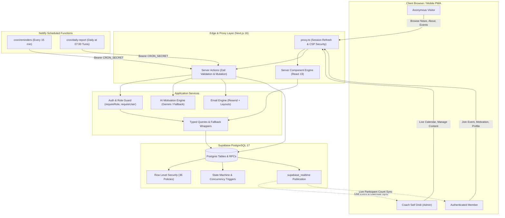
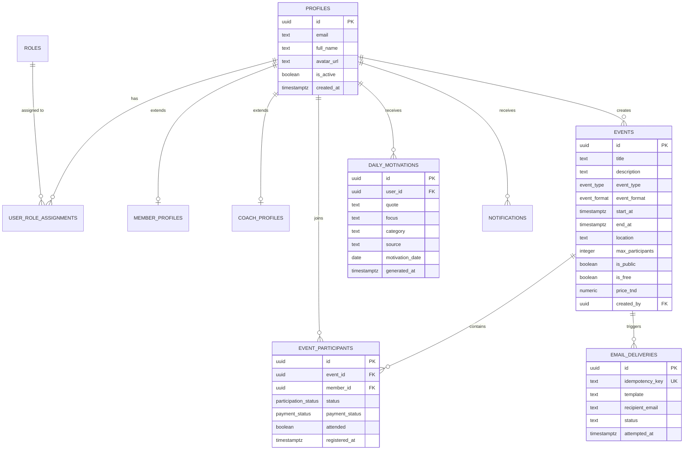

# 🥊 Fight Zone — Official Gym Platform & Community Hub

<div align="center">


### The Official Digital Platform of Coach Seif Dridi
**Train. Fight. Win.**

[](https://nextjs.org/)
[](https://react.dev/)
[](https://www.typescriptlang.org/)
[](https://tailwindcss.com/)
[](https://supabase.com/)
[](https://ai.google.dev/)
[](https://resend.com/)
[](https://www.netlify.com/)
[](tests/)
[](#-quality-gates--testing)

---

**Fight Zone** is an enterprise-grade, event-centric athletic platform engineered specifically for **Coach Seif Dridi** — elite boxing coach, athlete, and mentor. Designed from the ground up for high concurrency, real-time schedule synchronization, and frictionless athlete engagement, the platform connects Coach Seif directly with his fighters and fitness enthusiasts.

</div>

---

## 👥 Development Team

This official software platform was designed, engineered, and deployed by **Karim Feki** and **Nesrine Derouiche**.

| Avatar | Name | Role | Links |
| :---: | :--- | :--- | :--- |
|  | **Karim Feki** | **Co-Lead Full-Stack Developer & Solutions Architect**<br>• Backend System Architecture & Domain Modeling<br>• Supabase Infrastructure & 36 RLS Migrations<br>• Realtime Concurrency, RPCs & PostgreSQL Triggers<br>• Security Hardening, Observability & Disaster Recovery | [GitHub](https://github.com/fekikarim) • [LinkedIn](https://www.linkedin.com/in/karimfeki) • [Portfolio](https://karimfeki.is-a.dev) |
|  | **Nesrine Derouiche** | **Co-Lead Full-Stack Developer & Product Engineer**<br>• Frontend Architecture & Arena Dark Design System<br>• Interactive Calendar & Event Participation Workflows<br>• AI Motivational Coach (Gemini & Fallback Engine)<br>• Automated Email Infrastructure & Netlify Cron Jobs | [GitHub](https://github.com/nesrine-derouiche) • [LinkedIn](https://linkedin.com/in/nesrine-derouiche) • [Portfolio](https://nesrine-derouiche.is-a.dev) |

### 🥊 Client & Head Coach
* **Client / Head Coach**: [**Seif Dridi**](https://www.facebook.com/seif.dridi2) (Head Coach & Founder, Fight Zone)
* **Official Facebook**: [facebook.com/seif.dridi2](https://www.facebook.com/seif.dridi2)
* **Specialization**: Professional Boxing, Kickboxing, Physical Conditioning, Athlete Development

---

## 📚 Production Documentation Suite

| Document | Scope & Purpose |
| :--- | :--- |
| 📘 [**System Architecture & Technical Specifications**](docs/SYSTEM_ARCHITECTURE_AND_SPECIFICATION.md) | **Authoritative System Manual**: Full architectural blueprints, 36-migration schema lineage, database triggers, state machines, AI engine fallback logic, and Netlify cron workflows. |
| 🚨 [**Disaster Recovery Runbook**](docs/operations/disaster-recovery.md) | Verified PostgreSQL 17 restore rehearsals, RTO/RPO targets, and native `pg_dump` contingency procedures. |
| 📊 [**Observability & Logging Runbook**](docs/operations/observability.md) | Structured single-line JSON logging standard (`[fight-zone]`), request ID tracing, and alerting thresholds. |
| 🤖 [**Daily AI Motivation Engine**](docs/daily-ai-motivation.md) | Deep dive into the Gemini 3.5 Flash integration, Zod schema validation, and deterministic fallback library. |
| 📰 [**Coach News & Events Management**](docs/coach-news-events.md) | Content engine, publishing workflows, category metadata, and real-time freshness indicators. |

---

## 📋 Table of Contents

1. [Production Documentation Suite](#-production-documentation-suite)
2. [Executive Summary & Core Business Model](#-executive-summary--core-business-model)
3. [High-Level Architecture](#-high-level-architecture)
4. [Technology Stack](#-technology-stack)
5. [System Features & Functional Breakdown](#-system-features--functional-breakdown)
   - [Public Marketing Arena](#1-public-marketing-arena)
   - [Event-Centric Participation Engine](#2-event-centric-participation-engine)
   - [Coach Seif Dridi Operations & Live Calendar](#3-coach-seif-dridi-operations--live-calendar)
   - [Authenticated Member Portal](#4-authenticated-member-portal)
   - [Daily AI Motivational Coach](#5-daily-ai-motivational-coach)
   - [Event Email Automation & Idempotent Delivery](#6-event-email-automation--idempotent-delivery)
6. [Security & Authorization Architecture](#-security--authorization-architecture)
7. [Database Schema & State Machine Specifications](#-database-schema--state-machine-specifications)
8. [API Routes & Scheduled Cron Handlers](#-api-routes--scheduled-cron-handlers)
9. [Quality Gates & Automated Testing](#-quality-gates--automated-testing)
10. [Deployment & Environment Configuration](#-deployment--environment-configuration)
11. [Local Development & Operations Runbook](#-local-development--operations-runbook)
12. [Disaster Recovery & Observability Protocols](#-disaster-recovery--observability-protocols)

---

## 🎯 Executive Summary & Core Business Model

Fight Zone replaces generic subscription and checkout-based SaaS patterns with an **event-driven, locally-settled community model** tailored precisely to combat sports gyms and personal coaching:

```text
┌─────────────────────────────────────────────────────────────────────────────┐
│                            THE FIGHT ZONE LOOP                              │
├─────────────────────────────────────────────────────────────────────────────┤
│                                                                             │
│   Coach Seif Dridi creates Events (Group Masterclasses / 1-on-1 Sessions)   │
│                                     │                                       │
│                                     ▼                                       │
│          Events appear instantly in Coach Calendar & Member Feed            │
│                                     │                                       │
│                                     ▼                                       │
│            Members verify spots (Database serialized via Row Locks)         │
│                                     │                                       │
│                                     ▼                                       │
│          Capacity decrements in Real-Time across all active clients          │
│                                     │                                       │
│                                     ▼                                       │
│         Automated Email Reminders fire 30 min before start (Resend)         │
│                                     │                                       │
│                                     ▼                                       │
│      Attendance & Cash Payments confirmed on-site with Coach before bout    │
│                                     │                                       │
│                                     ▼                                       │
│      Cancellations safely release capacity + trigger Coach alerts           │
│                                                                             │
└─────────────────────────────────────────────────────────────────────────────┘
```

### Key Principles:
- **Event-Centric Delivery**: Training is booked via scheduled collective training events or individual private coaching (capacity-1) sessions.
- **Cash / On-Site Settlement**: Transparent local payment tracking (`UNPAID` / `PAID` / `NOT_REQUIRED`) confirmed exclusively by staff on-site. Eliminates unnecessary transaction fees and payment gateway dependencies.
- **Single Source of Truth**: Postgres database-level serializability (`SELECT ... FOR UPDATE`), zero-trust server validation, and Row-Level Security (RLS).
- **Graceful Fault Tolerance**: If external services (AI or external email providers) experience transient outages, the platform gracefully degrades to curated internal fallback libraries without impacting user experience.

---

## 🏗 High-Level Architecture

The platform is designed around a modern Serverless Next.js 16 App Router paired with Supabase (PostgreSQL 17), Supabase Realtime, and Netlify Scheduled Functions.



---

## 💻 Technology Stack

| Layer | Technology | Version | Purpose |
| :--- | :--- | :--- | :--- |
| **Framework** | Next.js (App Router, Turbopack) | `16.3.0` | Server Components, Server Actions, Dynamic Rendering |
| **Runtime** | React / React DOM | `19.2.8` | Component model, Concurrent features, Optimistic UI |
| **Language** | TypeScript | `5.0+` | Full-stack strict typing, schema alignment, zero any |
| **Styling** | Tailwind CSS (PostCSS plugin) | `v4.0` | Custom Arena Dark design system, responsive layouts |
| **Database** | PostgreSQL via Supabase | `17.x` | Relational storage, RLS, DB functions, Triggers, RPCs |
| **Client Auth/SSR**| `@supabase/ssr` & `@supabase/supabase-js` | `0.12.4` / `2.112.3` | Cookie-backed SSR sessions, client/server/admin clients |
| **Artificial Intelligence**| Google Generative AI (`gemini-3.5-flash`) | `0.24.1` | Daily personalized athlete motivation quotes |
| **Email Infrastructure**| Resend API | `6.22.1` | Idempotent transactional and reminder notifications |
| **Form Management**| React Hook Form + Resolvers | `7.85.0` / `5.9.0` | Controlled, accessible forms with instant client feedback |
| **Validation** | Zod | `4.4.3` | Contract verification across client forms and server actions |
| **Icons** | Lucide React | `1.31.0` | Consistent iconography across admin and member interfaces |
| **Hosting & Schedulers**| Netlify Functions & Serverless | `6.0.0` | Global CDN, edge deployments, scheduled cron handlers |
| **Testing** | TSX & Custom Assertion Suites | `4.23.15` | Unit and integration test runners |

---

## ⚡ System Features & Functional Breakdown

### 1. Public Marketing Arena
* **Hero Experience**: Bold athletic visual branding featuring high-definition gym illustration assets, dynamic typography (Oswald + Geist), and immediate conversion triggers.
* **About Coach Seif Dridi (`/about`)**: Comprehensive career history, official palmares (honors, championship belts, and medals), years of coaching, and discipline tags (Boxing, Kickboxing, Conditioning).
* **Direct Coach Contact (`/contact`)**: Zod-validated contact form transmitting inquiries directly into database records and dispatching real-time notifications to staff.
* **Events Discovery (`/events`)**: Public event cards displaying event date, duration, location, instructor, format (COLLECTIVE or INDIVIDUAL), price in TND (or Free), and spot availability indicators.
* **Coach News Portal (`/news` & `/news/[slug]`)**: Categorized articles (`TRAINING`, `NUTRITION`, `COMPETITION`, `COMMUNITY`, `ANNOUNCEMENT`) with rich markdown rendering, author byline, and SEO metadata.

### 2. Event-Centric Participation Engine
* **Spot Reservation Concurrency**: Postgres trigger `enforce_event_registration` locks event rows using `SELECT ... FOR UPDATE`, guaranteeing that simultaneous registrations never oversell limited slots.
* **Re-join Support**: Members who previously cancelled can re-join an open event seamlessly; their record transitions back to `JOINED` while enforcing current capacity limits and resetting attendance flags.
* **Cash Settlement Flow**: Clear indicators explaining that payment is settled in cash with Coach Seif prior to the session.
* **Realtime Feed Updates**: The event participation state is broadcast over Supabase Realtime so that slot counts reflect immediately on open client pages.

### 3. Coach Seif Dridi Operations & Live Calendar
* **Tri-View Interactive Calendar (`/admin/calendar`)**:
  - **Month View**: Bird's-eye schedule mapping with participant capacity badges.
  - **Week View**: Hourly time-grid showing active and upcoming fight sessions.
  - **Agenda / Today View**: Step-by-step rundown of daily bouts, participants, and check-in statuses.
* **Realtime Attendance & Cash Reconciliation**: Staff can toggle participant status (`JOINED`, `ATTENDED`, `NO_SHOW`, `CANCELLED`) and payment status (`UNPAID` vs `PAID`) with immediate database commits.
* **Event Creation & Modification Modal**: Comprehensive form supporting format selection (`COLLECTIVE` vs `INDIVIDUAL`), private vs public visibility, participant caps, pricing, and cover images.
* **News Management (`/admin/news`)**: Direct draft/publish controls, slug collision handling, and excerpt generation.

### 4. Authenticated Member Portal
* **Unified Dashboard (`/member`)**: Personalized hub showing upcoming enrolled sessions, recent gym notifications, and profile status.
* **Live Schedule Browser (`/member/events`)**: Direct view of all open sessions with single-click reservation and cancellation controls.
* **Profile Management (`/member/profile`)**: Athletes configure skill level (`BEGINNER`, `INTERMEDIATE`, `ADVANCED`, `PROFESSIONAL`), height, weight, emergency contacts, and personal bio.
* **Staff Preview Mode**: Coaches can toggle into member view mode (`/preview`) using secure HMAC cookies to inspect the exact member interface without altering authentication tokens.

### 5. Daily AI Motivational Coach
* **Once-Per-Day Delivery**: Triggers once daily per member upon entering their portal, evaluated via database timestamp in the `Africa/Tunis` timezone.
* **Provider Abstraction (`lib/ai/`)**:
  - **Google Gemini Provider**: Interacts with `gemini-3.5-flash` using structured JSON output instructions, validated strictly via Zod.
  - **Curated Fallback Library**: Curated database of fight-tested motivation quotes that guarantees flawless user experience if external APIs are unreachable or disabled.
* **Atomic Concurrency**: Backend uses `ON CONFLICT ... DO NOTHING` ensuring duplicate tabs or concurrent requests never produce conflicting entries.

### 6. Event Email Automation & Idempotent Delivery
* **Idempotent Claim-and-Mark Pattern**: Backed by the `email_deliveries` log and PostgreSQL security-definer functions (`claim_email_delivery` & `mark_email_delivered`), eliminating duplicate emails even under serverless retry loops.
* **30-Minute Event Reminders**: Automatically dispatched to Coach Seif and all enrolled members 30 minutes prior to scheduled start times.
* **Daily 07:00 AM Coach Digest**: Comprehensive schedule briefing sent to Coach Seif every morning at 07:00 AM (Tunis time) summarizing the day's training itinerary and attendee rosters.
* **Cancellation & Empty-Event Alerts**: Instant alert sent to Coach Seif when an athlete cancels, with automated alerts triggered if an event participant count drops to zero.

---

## 🔒 Security & Authorization Architecture

Fight Zone enforces a multi-layered security model where the database serves as the authoritative boundary:

```text
┌────────────────────────────────────────────────────────────────────────┐
│                        SECURITY DEFENSE IN DEPTH                       │
├────────────────────────────────────────────────────────────────────────┤
│ 1. Network / Edge     │ Next.js CSP Headers, nosniff, frame-ancestors, │
│                       │ proxy.ts cookie session refresh                │
├───────────────────────┼────────────────────────────────────────────────┤
│ 2. App Routing        │ requireUser(), requireRole(['ADMIN', 'COACH']) │
│                       │ Email confirmation check (email_confirmed_at)  │
├───────────────────────┼────────────────────────────────────────────────┤
│ 3. Server Action Trust│ Zod Schema Validation on every input payload,  │
│                       │ server-only execution boundaries               │
├───────────────────────┼────────────────────────────────────────────────┤
│ 4. Database Boundary  │ PostgreSQL 17 Row-Level Security (RLS) on all  │
│                       │ tables; SECURITY DEFINER RPCs with fixed path  │
└────────────────────────────────────────────────────────────────────────┘
```

### Role Model:
- **`MEMBER`**: Default role assigned upon email verification. Access restricted to own profile, registered events, own notifications, and motivation cards.
- **`COACH`**: Operational staff role. Permits schedule management, viewing event attendee rosters, and updating attendance markers.
- **`ADMIN`**: Complete administrative oversight. Covers news publication, event creation, role assignment, and financial tracking.

*Note: Roles are stored exclusively in the `user_role_assignments` database table — never in client-side JWT claims or unverified session cookies.*

---

## 🗄 Database Schema & State Machine Specifications

The system is governed by **36 version-controlled migrations** in `supabase/migrations/`.



### Event Participation State Machine:
Enforced via PostgreSQL trigger `enforce_participation_transitions`:
- `INTERESTED` ➔ `JOINED` | `CANCELLED`
- `JOINED` ➔ `CANCELLED` | `ATTENDED` | `NO_SHOW`
- `CANCELLED` ➔ `JOINED` *(Re-join permitted if capacity allows)*
- `ATTENDED` & `NO_SHOW` ➔ *Terminal States (Staff-controlled)*

---

## 🔌 API Routes & Scheduled Cron Handlers

| Route | HTTP Method | Authentication | Purpose |
| :--- | :--- | :--- | :--- |
| `/api/cron/reminders` | `POST` | `Bearer CRON_SECRET` | Dispatches 30-min event alerts to Coach Seif and participants |
| `/api/cron/daily-report` | `POST` | `Bearer CRON_SECRET` | Compiles and delivers the 07:00 AM Coach Daily Schedule Digest |
| `/api/health` | `GET` | Public | System uptime, database connectivity, and timestamp probe |
| `/sign-out` | `POST` | Authenticated | Clears SSR session cookies and revalidates cache |

---

## 🧪 Quality Gates & Automated Testing

The Fight Zone codebase enforces zero-defect quality gates. Every release is validated through static and behavioral suites:

```bash
# 1. Type Verification (Strict Zero Emit)
npx tsc --noEmit

# 2. Code Standards & Linter (0 warnings, 0 errors)
npm run lint

# 3. Automated Test Suite (72 passing tests)
npm test
```

### Test Suite Distribution:
- **`content-freshness.test.ts` (22 Tests)**: Validates real-time news and event dot indicators, per-user seen keys, marker storage, and unread event transitions.
- **`preview.test.ts` (10 Tests)**: Enforces allowlist validation for the Staff Preview Mode cookie and blocks path traversal attempts.
- **`email.test.ts` (40 Tests)**: Verifies HTML email rendering, plain-text generation, link escaping, XSS sanitization, and preheader formatting across all 7 operational email templates.

---

## 🚀 Deployment & Environment Configuration

### Required Environment Variables

Create `.env.local` based on `.env.example`:

```env
# Supabase Configuration
NEXT_PUBLIC_SUPABASE_URL=https://<your-project>.supabase.co
NEXT_PUBLIC_SUPABASE_PUBLISHABLE_KEY=sb_publishable_<your-key>
NEXT_PUBLIC_SITE_URL=https://fightzone.app

# Server-Only Service Role (Email automation & Background Tasks)
SUPABASE_SERVICE_ROLE_KEY=service_role_<your-key>

# Cron Security Token (Matches Netlify Environment Variable)
CRON_SECRET=<your-high-entropy-random-string>

# Resend Transactional Email Engine
RESEND_API_KEY=re_<your-resend-key>
RESEND_FROM_EMAIL=Fight Zone <noreply@fightzone.app>
RESEND_REPLY_TO_EMAIL=contact@fightzone.app

# Daily AI Motivational Coach (Google Gemini 3.5 Flash)
AI_MOTIVATION_ENABLED=true
GEMINI_API_KEY=AIza<your-gemini-key>
GEMINI_MODEL=gemini-3.5-flash
AI_MOTIVATION_TIMEOUT_MS=8000
```

---

## 🛠 Local Development & Operations Runbook

### Initial Setup
```bash
# Clone the repository
git clone https://github.com/fekikarim/fight-zone.git
cd fight-zone

# Install dependencies
npm install

# Populate local environment variables
cp .env.example .env.local

# Launch development server
npm run dev
```

### Supabase Database Tooling
```bash
# Launch local Dockerized Supabase (Optional)
npm run db:start

# Reset local database and execute all 36 migrations + seed data
npm run db:reset

# Link local repository with remote Supabase project
npm run db:link

# Deploy versioned migrations to remote production database
npm run db:push

# Synchronize TypeScript definitions from database schema
npm run db:types
```

---

## 🛡 Disaster Recovery & Observability Protocols

### Observability & Logging:
All system events and unexpected behaviors are captured using single-line structured JSON logs prefixed with `[fight-zone]`:
- **Traceability**: Every request is assigned a unique `x-request-id` header generated by `proxy.ts`.
- **Sensitive Data Redaction**: Passwords, auth tokens, session cookies, and API keys are automatically stripped prior to logging.
- **Structured Error Taxonomy**: Errors are categorized into `VALIDATION`, `AUTHENTICATION`, `AUTHORIZATION`, `NOT_FOUND`, `CONFLICT`, `DB_CONSTRAINT`, `TIMEOUT`, and `CONNECTIVITY`.

### Disaster Recovery Rehearsal:
- **Verified Schema Rebuild**: Tested and verified on PostgreSQL 17 with an emergency RTO (Recovery Time Objective) of under 2 minutes.
- **Automated Backup Strategy**: High-priority database snapshots and Point-in-Time Recovery (PITR) procedures documented in [`docs/operations/disaster-recovery.md`](docs/operations/disaster-recovery.md).

---

<div align="center">

### Built with Pride for Coach Seif Dridi 🥊
**Fight Zone © 2026 — All Rights Reserved**

*Crafted by [Karim Feki](https://github.com/fekikarim) & [Nesrine Derouiche](https://github.com/nesrine-derouiche)*

</div>
