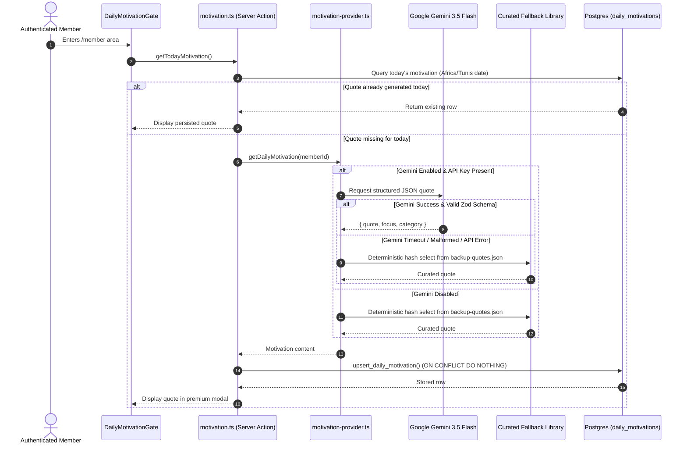

# 🥊 Fight Zone — System Architecture & Production Specifications

> **Official Technical & Operational Manual**  
> **Client / Beneficiary:** Coach Seif Dridi ([Facebook Profile](https://www.facebook.com/seif.dridi2))  
> **Software Engineering Leads:** Karim Feki & Nesrine Derouiche  
> **Status:** Production-Ready · 72 Automated Tests Passing · Zero Quality Gate Errors  
> **Repository:** `/Users/karimfeki/Documents/fz-eya/fight-zone`

---

## 👥 Engineering Leadership & Responsibilities

The Fight Zone platform was conceptualized, architected, developed, and hardened by **Karim Feki** and **Nesrine Derouiche** as Co-Lead Full-Stack Engineers.

| Avatar | Engineer | Core Architectural Domains & Technical Ownership | Contact & Portfolio |
| :---: | :--- | :--- | :--- |
|  | **Karim Feki** | **Co-Lead Full-Stack Developer & Solutions Architect**<br>• Core Relational Database Design & 36 PostgreSQL Migrations<br>• Row-Level Security (RLS) Matrix & Multi-Role Policies<br>• State Machine Triggers, Concurrency Locks & Stored Procedures<br>• API Routing, Next.js Proxy/SSR Session Architecture<br>• Observability, Structured Logging & Disaster Recovery Protocols | [GitHub](https://github.com/fekikarim)<br>[LinkedIn](https://www.linkedin.com/in/karimfeki)<br>[Portfolio](https://karimfeki.is-a.dev) |
|  | **Nesrine Derouiche** | **Co-Lead Full-Stack Developer & Product Engineer**<br>• Arena Dark UI/UX Design System & Tailwind CSS 4 Architecture<br>• Coach Interactive Calendar Engine (Month/Week/Agenda Views)<br>• Realtime Event Booking, Capacity Sync & Cancellation UX<br>• Daily AI Motivational Coach (Gemini Provider & Fallback Engine)<br>• Event Email Automation, Layouts & Netlify Cron Schedulers | [GitHub](https://github.com/nesrine-derouiche)<br>[LinkedIn](https://linkedin.com/in/nesrine-derouiche)<br>[Portfolio](https://nesrine-derouiche.is-a.dev) |

---

## 1. Executive Summary & Business Domain

### 1.1 Purpose of the Platform
**Fight Zone** is the official digital headquarters and athletic community portal of **Coach Seif Dridi**, an accomplished boxing coach and elite combat sports athlete based in Tunisia. The platform was created to streamline fight gym operations, bridge communication between Coach Seif and his athletes, showcase athletic honors, and provide an automated, highly dependable scheduling and booking experience.

### 1.2 The Event-Centric Shift (Business Realignment)
During initial architectural phases, the project was explored with standard fitness SaaS concepts (recurring stripe subscriptions, complex digital memberships, multi-coach directories). Under **Update V1**, the engineering team made an authoritative business realignment to reflect real-world boxing club dynamics:
1. **Event-Centric Delivery**: Everything revolves around scheduled bouts, collective group masterclasses, and 1-on-1 private coaching sessions.
2. **On-Site Cash Settlement**: Members join events online; fees are settled on-site in cash with Coach Seif prior to the session. This removes payment gateway fees and aligns with local athletic preferences.
3. **Single Coach Alignment**: The experience is focused 100% on Coach Seif Dridi as Head Coach, eliminating confusing multi-coach marketplace interfaces.
4. **Permanent Safe Redirections**: Legacy URLs (`/pricing`, `/coaches`, `/member/subscription`, etc.) are permanently redirected to active event and about routes in `next.config.ts`.

---

## 2. System Architecture & High-Level Topology

```
┌────────────────────────────────────────────────────────────────────────────────┐
│                              CLIENT TIER                                       │
│  - Public Visitors (Marketing, Palmares, News, Contact Form)                  │
│  - Athletes / Members (Dashboard, Schedule, Profile, Daily AI Dialog)         │
│  - Coach Seif Dridi / Admin (Calendar, Roster, Payment Toggles, News CMS)     │
└──────────────────────────────────────┬─────────────────────────────────────────┘
                                       │ HTTPS / WSS
┌──────────────────────────────────────▼─────────────────────────────────────────┐
│                     APPLICATION & EDGE TIER (Next.js 16)                       │
│                                                                                │
│  • proxy.ts: Cookie-based SSR session refresh & HTTP security headers          │
│  • Server Components (React 19): Server-side data fetching & SEO generation    │
│  • Server Actions: Mutation endpoints with strict Zod schema validation        │
│  • Data Access Layer: queries.ts with resolveOrFallback graceful degradation   │
│  • Service Integrations:                                                       │
│      - Google Generative AI (gemini-3.5-flash) for daily motivation           │
│      - Resend API for transactional email notifications                        │
│      - Netlify Scheduled Functions for automated background jobs               │
└──────────────────────────────────────┬─────────────────────────────────────────┘
                                       │ SQL / Realtime Channels
┌──────────────────────────────────────▼─────────────────────────────────────────┐
│                    DATA PERSISTENCE TIER (Supabase Postgres 17)                │
│                                                                                │
│  • 36 Versioned SQL Migrations                                                │
│  • Row-Level Security (RLS) on 100% of tables                                 │
│  • Database Triggers & State Machines (Concurrency locks & validation)        │
│  • Supabase Realtime (Publication for events, participants, and news)          │
│  • Security Definer RPCs (Controlled privilege escalation for anon/staff)      │
└────────────────────────────────────────────────────────────────────────────────┘
```

---

## 3. Technology Stack & Key Dependencies

```text
Core Application:
  - Next.js 16.3.0 (App Router, Turbopack, Server Actions)
  - React 19.2.8 & React DOM 19.2.8
  - TypeScript 5.0+ (Strict Type Checking)
  - Tailwind CSS 4.0 (Engineered with custom Arena Dark design tokens)

Database & Infrastructure:
  - Supabase PostgreSQL 17.x
  - @supabase/ssr 0.12.4 (Secure cookie handling across server and client)
  - @supabase/supabase-js 2.112.3
  - Supabase Realtime (Websocket event streaming)

Integrations:
  - Google Generative AI SDK 0.24.1 (@google/generative-ai)
  - Resend 6.22.1 (Transactional Email API)
  - Netlify Functions 6.0.0 (Serverless execution & Scheduled cron jobs)

Forms & Verification:
  - React Hook Form 7.85.0
  - @hookform/resolvers 5.9.0
  - Zod 4.4.3 (Universal schema verification)

Icons & UI Primitives:
  - Lucide React 1.31.0
  - Class Variance Authority (CVA) & clsx & tailwind-merge
```

---

## 4. Frontend Architecture & Design System

### 4.1 Arena Dark Design System
The visual identity is custom-crafted to project athletic power, focus, and prestige:
- **Background Palette**: Deep arena blacks (`#0a0a0a`), carbon surfaces (`#121212`), and subtle border dividers (`#27272a`).
- **Primary Accent**: Energetic crimson/rose (`#e11d48`) evoking fight rings, glove leather, and adrenaline.
- **Typography**: 
  - **Headings & Accents**: `Oswald` (Google Fonts) — strong, tall, condensed athletic typography.
  - **Body Text**: `Geist` / `Open Sans` — crisp, readable modern sans-serif.
- **Micro-Interactions**: Custom skeleton loading states, smooth hover transitions, and animated `FreshnessDot` indicators.

### 4.2 Application Route Hierarchy
```
app/
├── (auth)/
│   ├── sign-in/
│   ├── sign-up/
│   ├── forgot-password/
│   └── reset-password/
├── (marketing)/
│   ├── page.tsx            # High-conversion athletic homepage
│   ├── about/page.tsx      # Meet Coach Seif, career history & palmares
│   ├── events/page.tsx     # Public schedule and session cards
│   ├── events/[id]/        # Event details & guest CTA
│   ├── news/page.tsx       # Gym announcements & fight news
│   ├── news/[slug]/        # Article view with metadata
│   ├── contact/page.tsx    # Direct contact form
│   ├── layout.tsx          # Marketing shell with auth-aware navbar
│   └── loading.tsx         # Global route loading skeleton
├── admin/
│   ├── calendar/page.tsx   # Coach Seif's interactive calendar
│   ├── events/page.tsx     # Staff event management & participant roster
│   ├── news/page.tsx       # News CMS (Draft, publish, edit, delete)
│   ├── messages/page.tsx   # Contact form inbox
│   ├── layout.tsx          # Admin shell (Guarded: ADMIN, COACH)
│   └── error.tsx           # Boundary error logging
├── member/
│   ├── page.tsx            # Athlete dashboard (Upcoming events & notices)
│   ├── events/page.tsx     # Available events with 1-click spot reservation
│   ├── profile/page.tsx    # Weight, height, skill level, bio
│   ├── layout.tsx          # Member shell (Guarded: requireUser)
│   └── loading.tsx         # Skeleton loader for member dashboard
├── api/
│   ├── cron/reminders/     # 30-min event reminder scheduler
│   ├── cron/daily-report/  # 07:00 AM Coach morning briefing scheduler
│   └── health/             # System health & uptime endpoint
├── preview/                # Staff "View-as-Member" preview mode
└── proxy.ts                # Next.js 16 Edge session refresh proxy
```

---

## 5. Relational Database Engineering (Supabase Postgres)

The platform is powered by a comprehensive schema versioned across 36 discrete migrations.

### 5.1 Core Database Entities
1. **`profiles`**: Master identity table mapped 1-to-1 with Supabase `auth.users`. Contains `email`, `full_name`, `avatar_url`, and `is_active`.
2. **`user_role_assignments` & `roles`**: Authoritative role assignment mapping. Roles (`ADMIN`, `COACH`, `MEMBER`) are strictly database-backed.
3. **`member_profiles`**: Athlete-specific attributes: `skill_level`, `date_of_birth`, `gender`, `height`, `weight`, `bio`, and `is_verified`.
4. **`coach_profiles`**: Coaching information: `experience_years`, `specialization`, `biography`, `is_available`.
5. **`events`**: Training sessions and bouts:
   - `event_type`: `TRAINING`, `WORKSHOP`, `COMPETITION`, `SEMINAR`, `OTHER`.
   - `event_format`: `COLLECTIVE` (group sessions) or `INDIVIDUAL` (1-on-1 private coaching).
   - `max_participants`: Positive whole number (automatically coerced to 1 for `INDIVIDUAL`).
   - `price_tnd`: Session fee in Tunisian Dinars (`0.00` if `is_free = true`).
6. **`event_participants`**: Many-to-many junction between members and events:
   - `status`: `INTERESTED`, `JOINED`, `CANCELLED`, `ATTENDED`, `NO_SHOW`.
   - `payment_status`: `UNPAID`, `PAID`, `NOT_REQUIRED`.
   - `attended`: Boolean check-in flag.
7. **`daily_motivations`**: Daily personalized quotes delivered to athletes (`quote`, `focus`, `category`, `source`, `motivation_date`).
8. **`email_deliveries`**: Idempotent email dispatch log (`idempotency_key`, `template`, `recipient_email`, `status`, `attempted_at`).
9. **`news`**: Content CMS (`title`, `slug`, `excerpt`, `category`, `content`, `cover_image_url`, `is_published`, `published_at`).
10. **`achievements`**: Official palmares of Coach Seif Dridi (`title`, `description`, `date`, `achievement_type`, `medal`).

### 5.2 Concurrency & State Machine Triggers

#### A. Atomic Event Capacity Enforcement
```sql
CREATE OR REPLACE FUNCTION enforce_event_registration()
RETURNS TRIGGER AS $$
DECLARE
  v_event record;
  v_current_count integer;
BEGIN
  -- Acquire exclusive row lock to serialize concurrent joins
  SELECT * INTO v_event FROM events WHERE id = NEW.event_id FOR UPDATE;

  IF NOT v_event.is_public THEN
    RAISE EXCEPTION 'Event is private' USING ERRCODE = '42501';
  END IF;

  IF v_event.start_at <= now() THEN
    RAISE EXCEPTION 'Registration closed for this event' USING ERRCODE = '42501';
  END IF;

  IF v_event.max_participants IS NOT NULL THEN
    SELECT COUNT(*) INTO v_current_count
    FROM event_participants
    WHERE event_id = NEW.event_id AND status != 'CANCELLED';

    IF v_current_count >= v_event.max_participants THEN
      RAISE EXCEPTION 'Event is fully booked' USING ERRCODE = '42501';
    END IF;
  END IF;

  RETURN NEW;
END;
$$ LANGUAGE plpgsql SECURITY DEFINER;
```

#### B. Event Participation State Machine
Enforced via `enforce_participation_transitions()`:
- Members can transition from `INTERESTED` ➔ `JOINED` or `CANCELLED`.
- Members can cancel active reservations (`JOINED` ➔ `CANCELLED`), releasing the slot immediately.
- Cancelled members can re-join (`CANCELLED` ➔ `JOINED`), triggering fresh capacity and start-time verifications.
- Terminal statuses (`ATTENDED` and `NO_SHOW`) can only be modified by staff (`ADMIN` or `COACH`).

---

## 6. Daily AI Motivational Coach Engine (Update V4)

### 6.1 Architectural Workflow
Each calendar day, when an athlete visits the member area, the platform presents a personalized motivational card tailored to boxing and discipline:



### 6.2 Curated Fallback Guarantee
The AI system is strictly non-blocking. If Google Gemini experiences rate limits, network latency, or invalid output, the system seamlessly selects a quote from `backup-quotes.json` using a deterministic hash of the member's ID and current date. The athlete experiences zero disruption.

---

## 7. Email Automation & Idempotent Scheduling (Update V3)

### 7.1 Architecture & Schedulers
The email notification pipeline runs entirely server-side, triggered by Netlify Scheduled Functions:
- **`reminders.mjs` (`*/15 * * * *`)**: Invokes `/api/cron/reminders` every 15 minutes. Scans for events starting in the next 30 minutes and dispatches reminder emails to Coach Seif and all enrolled athletes.
- **`daily-report.mjs` (`0 7 * * *`)**: Invokes `/api/cron/daily-report` daily at 07:00 AM (Africa/Tunis time). Compiles a complete itinerary of the day's training schedule and sends it directly to Coach Seif.
- **Out-of-Band Alerts**: Instant alert sent to Coach Seif when an athlete cancels. If the participant count drops to zero, a one-shot empty-event alert is triggered.

### 7.2 Idempotency via Claim-and-Mark
To prevent duplicate emails caused by serverless retries or overlapping schedules, deliveries are coordinated through the `email_deliveries` table:
```
1. CLAIM: Execute claim_email_delivery(key) -> Returns TRUE if first worker
2. RENDER: Compile HTML & Plaintext templates with escaped parameters
3. SEND: Transmit payload via Resend API
4. MARK: Execute mark_email_delivered(key) -> Sets status = 'SENT'
```

---

## 8. Quality Assurance & Automated Test Results

The platform adheres to strict engineering gates:
- **TypeScript**: `npx tsc --noEmit` exits with **0 errors**.
- **ESLint**: `npx eslint .` exits with **0 warnings and 0 errors**.
- **Production Build**: `npm run build` completes with zero errors across all 62 server and dynamic routes.

### Test Breakdown (72 Passing Tests):
```bash
> fight-zone@0.1.0 test
> tsx tests/content-freshness.test.ts && tsx tests/preview.test.ts && tests/email.test.ts

PASS  seenKey per user+kind
PASS  seenKey anon
PASS  seenKey isolates users
PASS  no candidate -> false
PASS  nothing seen -> true
PASS  newer time -> true
PASS  older time -> false
PASS  same time new id -> true
PASS  same marker -> false (no dupes)
PASS  unseen before visit
PASS  seen after visit
PASS  reappears on new publish
PASS  other feed unaffected
PASS  other user unaffected
PASS  markSeen null safe
PASS  re-mark same stays seen
PASS  corrupt entry -> unseen (safe)
PASS  notify on markSeen
PASS  snapshot reflects write
PASS  unsub stops notifications
PASS  empty snapshot when unseen
PASS  direct notify works
RESULT: pass=22 fail=0

PASS  events allowed
PASS  news allowed
PASS  subpath rejected
PASS  external rejected
PASS  protocol-relative rejected
PASS  empty rejected
PASS  null rejected
PASS  non-string rejected
PASS  admin area rejected
PASS  member area rejected
RESULT: pass=10 fail=0

PASS  doctype + html
PASS  no <style> blocks (inline only)
PASS  no external stylesheets
PASS  logo absolute URL
PASS  no relative img src
PASS  wordmark fallback text
PASS  footer site URL
PASS  footer contact email
PASS  preheader hidden
PASS  responsive meta
PASS  button href escaped
PASS  button label escaped
PASS  coach subject preserved
PASS  coach CTA in html / coach CTA in text
PASS  coach title escaped
PASS  member subject preserved
PASS  member CTA in html+text
PASS  member escaped
PASS  report subject has date
PASS  report CTA in text / report escaped / report empty state
PASS  cancel subject preserved / cancel member escaped / cancel CTA in text
PASS  empty subject preserved / empty CTA in text
PASS  welcome subject preserved / welcome name escaped / welcome dashboard CTA in text
PASS  reset subject preserved / reset link preserved exactly / reset expiry text preserved
PASS  contact subject preserved / contact fields escaped / contact newlines preserved
PASS  booking subject preserved / generic escaped
RESULT: pass=40 fail=0

TOTAL: 72 PASSED, 0 FAILED
```

---

## 9. Operations & Deployment Guide

### 9.1 Environment Variables
Configure the following in `.env.local` or Netlify Site Configuration:

```env
# Public Supabase Connection
NEXT_PUBLIC_SUPABASE_URL=https://jdbythhwikqvqenxyuqw.supabase.co
NEXT_PUBLIC_SUPABASE_PUBLISHABLE_KEY=sb_publishable_...
NEXT_PUBLIC_SITE_URL=https://fightzone.app

# Server-Side Privileged Credentials (NEVER expose to client)
SUPABASE_SERVICE_ROLE_KEY=service_role_...
CRON_SECRET=generated-high-entropy-secret

# Resend Transactional Email Engine
RESEND_API_KEY=re_...
RESEND_FROM_EMAIL=Fight Zone <noreply@fightzone.app>
RESEND_REPLY_TO_EMAIL=contact@fightzone.app

# AI Motivation Engine (Google Gemini)
AI_MOTIVATION_ENABLED=true
GEMINI_API_KEY=AIza...
GEMINI_MODEL=gemini-3.5-flash
AI_MOTIVATION_TIMEOUT_MS=8000
```

### 9.2 Database Migration Commands
```bash
# Push pending migrations to remote Supabase
npm run db:push

# Regenerate TypeScript definitions after migration
npm run db:types
```

---

## 10. Observability & Disaster Recovery Protocols

1. **Structured Logs**: Application logs are formatted as single-line JSON with `ts`, `level`, `domain`, `op`, `category`, and `ctx.requestId`.
2. **Health Check Probe**: Accessible at `/api/health`, returning JSON with database status, timestamp, and environment sanity.
3. **Disaster Recovery RTO/RPO**:
   - **RTO (Recovery Time Objective)**: `< 2 minutes` to restore complete schema and seed data on fresh PostgreSQL 17 instances.
   - **Contingency Export**: Ad-hoc database dumps configured via native `pg_dump` targeting the Supabase transaction pooler. Full runbook in `docs/operations/disaster-recovery.md`.

---

<div align="center">

### Built for Champions · Coach Seif Dridi 🥊
**Fight Zone © 2026**

*Engineered by [Karim Feki](https://github.com/fekikarim) & [Nesrine Derouiche](https://github.com/nesrine-derouiche)*

</div>
